# Reading a Telkomsel NB-IoT Cell with an RTL-SDR and GNU Radio

*A cheap RTL-SDR dongle, a Windows laptop, and one GNU Radio flowgraph that finds an NB-IoT carrier at 935.4 MHz, locks onto it, works out which cell is talking, and reads everything that cell broadcasts to every device in range: its frame clock, its name, its network, its rules for joining and for paging sleeping meters. This is how the signal is built, how each block of the flowgraph takes it apart, and what cell 260 told me.*

[Code repo here](https://github.com/handiko/NBIoT-Rx)

---
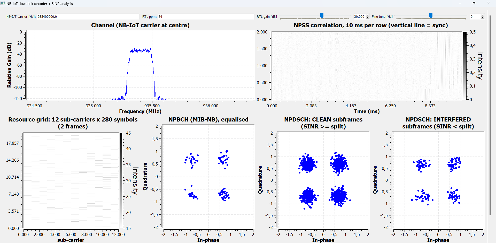
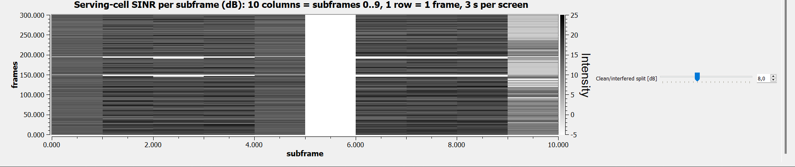

## Why I did this

Somewhere above my house a tower is talking to the electricity meters, water meters and trackers around me. It never stops. Every 10 milliseconds it sends a sync pulse, every 10 milliseconds it repeats a piece of its frame number, and every couple of seconds it tells anyone listening who it is and how to join. None of it is encrypted, because a meter that just woke up has no keys yet. It has to be able to read all of this cold.

That broadcast is **NB-IoT** (Narrowband Internet of Things): a 180 kHz slice of LTE, cut down for devices that send a few bytes a day and run for ten years on a battery. In my area, Telkomsel runs it in the old 900 MHz GSM band. 180 kHz fits comfortably inside an RTL-SDR's 2 MHz, so this is one LTE-family signal a 10-dollar dongle can actually decode end to end.

I wanted to see it with my own eyes, and as usual I wanted to build the decoder myself in GNU Radio on my Windows laptop, so that every step is something I can look at. No srsRAN, no OOT modules, no compiled helpers. This flowgraph, `nbiot_rx_sinr.grc`, is my first experiment with it, and this document is the story of that first run.

- **Parts 1 to 4** explain the signal: where it sits, how it is modulated, how time is cut up, and what goes in each square of a frame.
- **Parts 5 to 9** follow the samples through the flowgraph: front end, sync, FFT, channel estimation, error correction.
- **Parts 10 to 14** decode the broadcast messages, line by line, exactly as my console printed them.
- **Part 15** is about frequency reuse: what it means that every Telkomsel NB-IoT cell shares one frequency, and how I could see the neighbours in my own data.
- **Part 16** is the run in numbers.

A few DSP and LTE words will show up (OFDM, QPSK, resource element, CRC, Viterbi, ASN.1…). I explain each one the first time I use it. Where I'm interpreting rather than reading a number straight off the log, I say how sure I am.

---

## What I used

- **RTL-SDR dongle** (R820T), tuned to 935.7 MHz, 1.92 MS/s, gain 30 dB, ppm correction 34 (the same value I use in Gqrx).
- **A simple antenna** for the 900 MHz band, indoors.
- **Windows laptop** with **radioconda** (GNU Radio 3.10). Stock blocks, two Embedded Python Blocks, and one Python Module block holding the maths. numpy inside, plus **pycrate** to print the ASN.1 messages.
- **3GPP TS 36.211, 36.212, 36.213, 36.331 and 36.304**: the LTE/NB-IoT specifications for the physical layer, the coding, the procedures, the radio messages and idle-mode behaviour. Everything the decoder does comes from these.

The files:

- **nbiot_rx_sinr.grc**: the flowgraph. It's self-contained: the Python Module and both Python blocks live inside it.
- **nbiot_rx_sinr_explained.md**: the short technical note for the SINR displays.
- **nbiot_pe_\*.svg**: the fourteen diagrams in this document. Keep them in the same folder.

---

## The rule I followed

Same rule as every one of my GNU Radio projects:

> Put each operation in a stock block if one exists. Use an Embedded Python Block (EPB) only for what GNU Radio cannot do natively.

For NB-IoT that split falls in an interesting place. Tuning, filtering, gain control, the FFT that turns time into subcarriers, picking the 12 subcarriers that belong to NB-IoT, and all the displays: stock blocks. Finding the sync pulse at an unknown frequency, cutting the stream into exactly-aligned OFDM symbols, estimating the radio channel, undoing the error-correcting code and following the broadcast timetable: no stock block can do any of those, so they are Python.

Here's the whole receiver on one page:

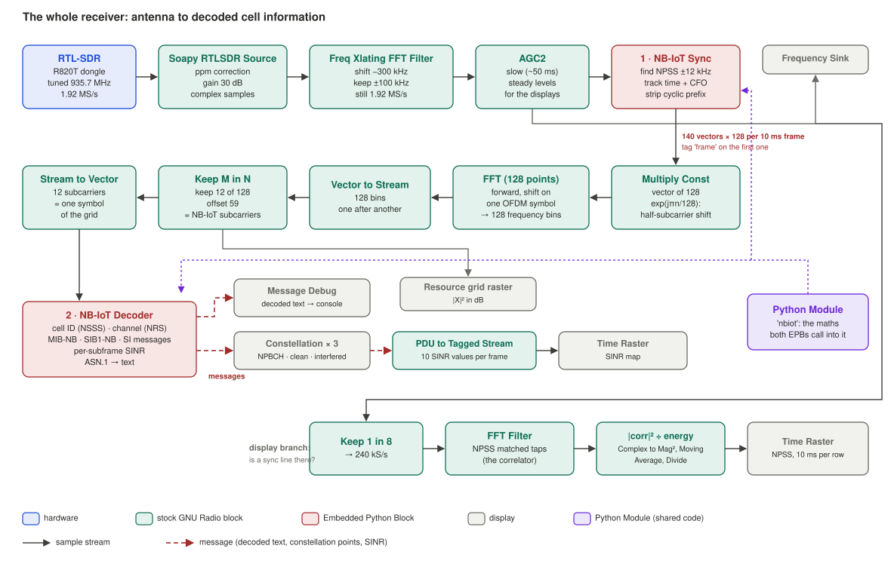

Blue is hardware, green boxes are stock blocks, coral ones are my two Python blocks, grey ones are displays, and the violet one is the Python Module, the shared library both Python blocks call into. Solid arrows carry samples. Dashed arrows carry messages: decoded text, constellation points, SINR values.

Notice the shape. Samples go *into* Python (block 1), come *out* again into stock blocks for the FFT, and go back into Python (block 2). Block 1 only has to do the one thing the FFT block can't: decide exactly where each OFDM symbol starts. Once it has, the FFT is an ordinary stock FFT.

---

## Part 1: where the carrier lives

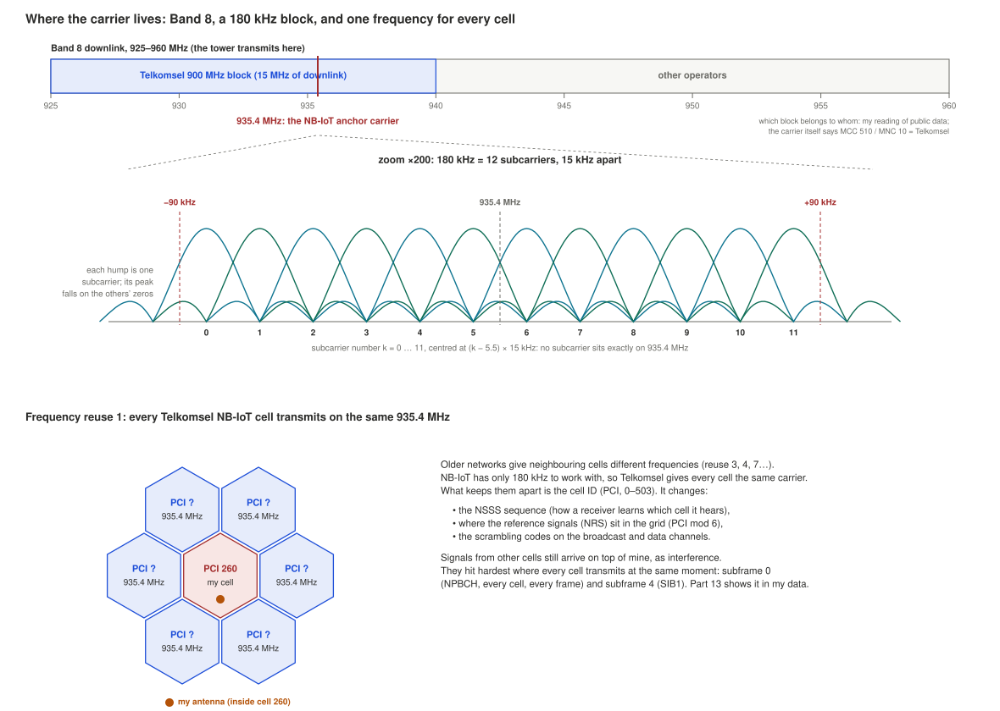

### A 180 kHz island in the GSM band

Band 8 is the 900 MHz band: towers transmit between 925 and 960 MHz. It was GSM territory for decades, and operators are slowly reusing it for LTE and NB-IoT. Telkomsel's NB-IoT anchor carrier here is at **935.4 MHz**.

It runs in **standalone** mode, which my decoder confirmed from the MIB-NB (Part 10): it isn't tucked inside an LTE carrier ("in-band") or in an LTE carrier's edge ("guard-band"). It has its own 200 kHz slot, exactly like one old GSM channel. Standalone carriers sit on the 100 kHz raster, so 935.4 is a legal spot; in LTE channel numbers it's EARFCN 3554.

### Twelve subcarriers

Zoom in 200 times and the 180 kHz block is **12 subcarriers, 15 kHz apart**. Each one is a little carrier of its own, and each one carries one number per OFDM symbol (Part 2). They overlap, as the humps in the picture do, but the peak of each hump falls exactly on the zeros of all the others, so they don't disturb each other. That trick is called **orthogonality**, and it only works if my receiver lands within a small fraction of 15 kHz of the right frequency. That's why the sync block spends so much effort on frequency (Part 6).

One detail matters later: the subcarriers sit at (k − 5.5) × 15 kHz from the centre, for k = 0 … 11. No subcarrier sits on 935.4 MHz itself. Everything is shifted by half a subcarrier (7.5 kHz). Part 7 shows the single stock block that undoes this.

### One frequency for every cell

Older networks give neighbouring cells different frequencies: reuse 3, 4 or 7, like colouring a map so no two neighbours share a colour. NB-IoT doesn't have spectrum to spare (Telkomsel wouldn't give it seven 200 kHz slots), so every NB-IoT cell uses **the same 935.4 MHz**. That's **frequency reuse 1**.

What keeps the cells apart is the **cell ID**, the PCI (physical cell identity, 0 to 503). The PCI changes:

- the NSSS sequence, which is how a receiver learns which cell it hears (Part 6);
- where the reference signals sit in the grid (PCI mod 6, Part 8);
- the scrambling codes on the broadcast and data channels (Part 9).

The cell I hear best is **PCI 260**. The others are still there on the same frequency, quieter, and Part 15 shows exactly where in each frame they leak into my measurements.

How sure am I that this is reuse 1 and not just one lonely carrier? **High.** Three independent pieces of evidence: the cell's own SIB3 lists no other frequency to search (Part 13), my SINR dips exactly in the subframes every cell broadcasts at once (Part 15), and NB-IoT networks are designed this way. The one thing I can't do with my setup is name the neighbouring PCIs: they were all below my cell-search threshold.

---

## Part 2: the radio wave: OFDM, cyclic prefix, QPSK

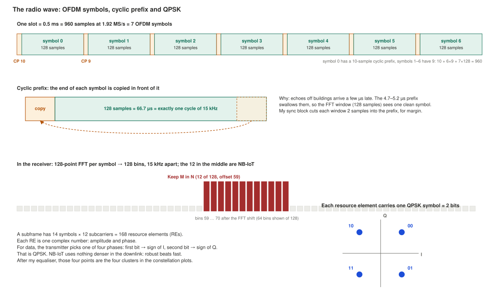

### OFDM in one paragraph

**OFDM** (orthogonal frequency-division multiplexing) sends many slow subcarriers side by side instead of one fast carrier. The tower picks one complex number for each of the 12 subcarriers, runs an inverse FFT, and sends the result as one **OFDM symbol**, 66.7 µs long (one full cycle of 15 kHz). My receiver does the opposite: it cuts out one symbol's worth of samples, runs an FFT, and gets the 12 numbers back.

At my sample rate of 1.92 MS/s, one symbol is exactly **128 samples**, so a 128-point FFT gives me 128 bins, 15 kHz apart, and the 12 in the middle are NB-IoT. (1.92 MS/s is the smallest standard LTE rate, and the RTL-SDR handles it happily.)

### The cyclic prefix

In front of each symbol, the tower sends a copy of the symbol's own last few microseconds: the **cyclic prefix** (CP). At 1.92 MS/s that's 10 samples for the first symbol of each slot and 9 for the others, so 7 symbols make 10 + 6 × 9 + 7 × 128 = **960 samples = 0.5 ms**, one **slot**.

Why waste the time? Because the signal reaches me by several paths (straight from the tower, bounced off buildings), and the bounced copies arrive a few microseconds late. Without a prefix, the end of one symbol would smear into the start of the next. With it, as long as I start my FFT window somewhere inside the prefix, the window contains one whole symbol and only that symbol. My sync block starts each window 2 samples into the prefix, for margin.

### QPSK: 2 bits per square

Each subcarrier in each symbol is one **resource element** (RE), one square of the grid in Part 4. For data, the tower puts one of four values in it: (±1 ± j)/√2. The first bit picks the sign of the real part (I), the second the sign of the imaginary part (Q). That's **QPSK**, quadrature phase-shift keying: 2 bits per RE.

NB-IoT downlink uses nothing denser. LTE goes up to 256-QAM (8 bits per RE), but NB-IoT is built for meters in basements, and QPSK is the most robust choice that still carries data. Robustness beats speed here. The four dots of my constellation plots are these four values.

---

## Part 3: time, from hyperframes down to symbols

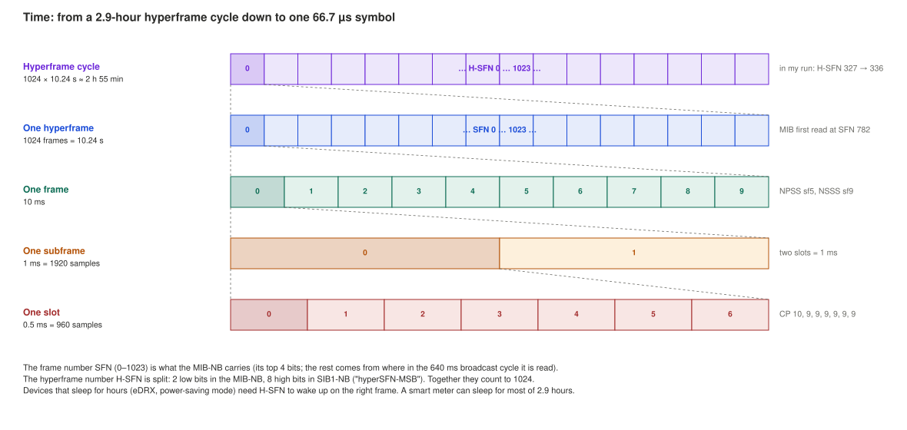

NB-IoT time is a set of nested counters, and the decoder has to know all of them, because every channel is scheduled by them:

| Unit | Length | Count | What it's for |
|---|---|---|---|
| **Symbol** | 66.7 µs + CP | 7 per slot | one column of the grid |
| **Slot** | 0.5 ms | 2 per subframe | cyclic-prefix pattern repeats |
| **Subframe** | 1 ms | 10 per frame | the unit things are scheduled in |
| **Frame** | 10 ms | SFN 0 … 1023 | NPSS once per frame, so this is the "beat" |
| **Hyperframe** | 10.24 s | H-SFN 0 … 1023 | for devices that sleep for hours |
| **Hyperframe cycle** | 2 h 55 min | – | everything repeats |

The **SFN** (system frame number) counts frames 0 to 1023, then wraps. The **H-SFN** (hyperframe number) counts those wraps. A smart meter in deep sleep (eDRX, the extended sleep mode NB-IoT is famous for) can be told "wake up in hyperframe 400" and sleep for most of three hours.

Neither counter is ever sent whole in one place. The SFN is split between the MIB-NB message and *where in a 640 ms cycle* that message is received; the H-SFN is split between the MIB-NB (2 low bits) and SIB1-NB (8 high bits). Parts 10 and 11 show how I put them back together. In my run they read SFN 782 at the start, and the hyperframe went from **327 to 336** in 93 seconds.

---

## Part 4: one frame, square by square

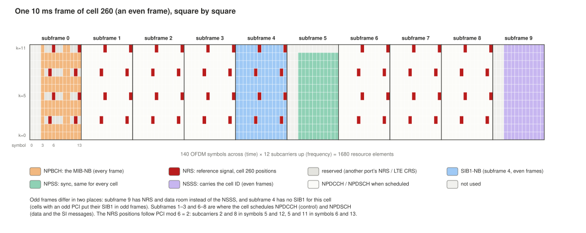

A frame is 140 symbols × 12 subcarriers = **1680 squares**, and each kind of square has a job. This is an even frame of cell 260:

| Name | Where | What it carries |
|---|---|---|
| **NPSS** (narrowband primary sync signal) | subframe 5 of *every* frame, symbols 3–13, subcarriers 0–10 | the same 11-number Zadoff-Chu sequence in every cell on Earth. "A frame starts here." |
| **NSSS** (secondary sync) | subframe 9 of *even* frames, all 12 subcarriers | a sequence chosen by the PCI: "I am cell 260". It also changes every 2 frames, which hints where I am in an 80 ms cycle. |
| **NRS** (narrowband reference signal) | 8 squares in each subframe that has them, at PCI-dependent positions | known values, so the receiver can measure the radio path (Part 8) |
| **NPBCH** (broadcast channel) | subframe 0 of every frame, 100 squares | the MIB-NB: frame number, where SIB1 is, operating mode (Part 10) |
| **NPDSCH carrying SIB1-NB** | subframe 4 of even frames (cell 260 has an even PCI) | who the network is and how to join (Part 11) |
| **NPDCCH / NPDSCH** | subframes 1–3 and 6–8, and 9 in odd frames | control and data when scheduled, including the SI messages (Parts 11 and 13) |

The grey squares inside subframe 0 are reserved: NB-IoT always leaves room there for a second antenna port's NRS and for LTE's reference signals, so that the same NPBCH layout works in every mode. 11 symbols × 12 subcarriers is 132 squares; take out the 32 reserved ones and 100 remain for the MIB-NB.

For cell 260 (260 mod 6 = 2), the NRS sit on subcarriers 2 and 8 in symbols 5 and 12, and on subcarriers 5 and 11 in symbols 6 and 13. A cell with a different PCI puts them somewhere else, which is the detail Part 15 hangs on.

That's the whole signal. Now the receiver.

---

## Part 5: the front end, all stock blocks

Four stock blocks get the radio signal into shape:

1. **Soapy RTLSDR Source** tunes the dongle to **935.7 MHz**, 300 kHz *above* the carrier, at 1.92 MS/s, with my 34 ppm correction. Why not tune straight to 935.4? Every RTL-SDR has a spike at the exact centre of its spectrum (DC offset and I/Q imbalance). Tuning 300 kHz away moves that spike far outside the 180 kHz I care about.
2. **Frequency Xlating FFT Filter** shifts the spectrum by −300 kHz, so NB-IoT lands at 0 Hz, and low-pass filters it to ±100 kHz with a 30 kHz transition band. It keeps the 1.92 MS/s rate, because the FFT needs exactly 128 samples per symbol. The filter is a little wider than 180 kHz so it doesn't eat the outer subcarriers. It also has a **Fine tune** slider, which I leave at 0: the sync block finds the exact frequency by itself.
3. **AGC2**, slow (about 50 ms), keeps the signal level steady for the displays and the correlator. It's slow enough not to change gain inside an OFDM symbol, and anyway the channel estimate in Part 8 absorbs any level change.
4. **Frequency Sink** shows the spectrum, centred on 935.4 MHz: a flat-topped 180 kHz block.

The startup log shows GNU Radio enlarging three buffers (`set_min_output_buffer … 2097152` on the AGC). That's deliberate: the decoder sometimes thinks for a while (a Viterbi run, an ASN.1 decode), and a big buffer lets the dongle keep streaming while it does, instead of dropping samples.

There's also a small **display branch**: Keep 1 in 8 (down to 240 kS/s), an FFT Filter whose taps are the NPSS waveform, then |output|² divided by the moving signal energy, into a Time Raster. That's a stock-block NPSS correlator: if there's an NB-IoT cell, a bright vertical line appears, one dot per 10 ms row. It does nothing for the decoding. It's there so I can *see* the sync before believing any decoder.

---

## Part 6: Python block 1, the Sync

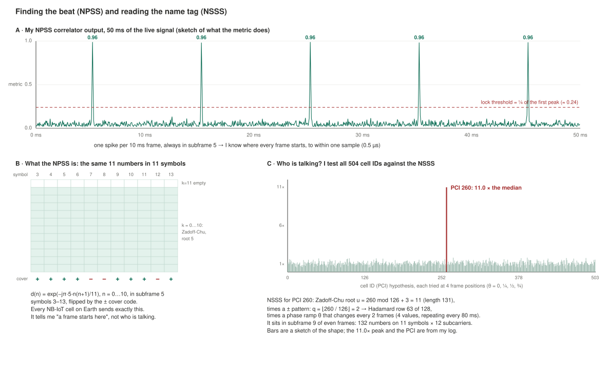

The first Python block turns an endless stream of samples into neat **frames: 140 symbols × 128 samples**, each cut at exactly the right place, with the frequency error removed. Everything downstream depends on this being right to within a sample.

### Finding the beat

The NPSS is my anchor. It's always the same, always in subframe 5, always 11 symbols long: an 11-number **Zadoff-Chu sequence** (a complex sequence with the useful property that it only matches itself at one exact alignment) with a ± **cover code** flipping whole symbols. I know exactly what it looks like in time, so I slide that template along the incoming samples and measure how well they match: the **correlation metric**, from 0 (nothing) to 1 (perfect match).

The catch is frequency. My dongle's crystal is off by some ppm, and at 935 MHz each ppm is 935 Hz. A template at the wrong frequency rotates against the signal and the match falls apart. So on startup the Sync block searches **±12 kHz in 250 Hz steps**, at 240 kS/s to keep it fast, over 4 frames, using FFTs so that each frequency guess is just a shifted copy of the same spectrum. It keeps the best match only if it stands at least 12 times above the typical value. Then it refines time and frequency at the full 1.92 MS/s.

My log, first line of the run:

```
[sync] NPSS found: metric 0.97, CFO +912.8 Hz (+0.98 ppm at 935 MHz), half-subcarrier per-symbol, frame start at sample 12391
```

- **metric 0.97**: a near-perfect match. Noise gives about 0.02.
- **CFO +912.8 Hz**: carrier frequency offset, how far the signal is from where I expected it. +0.98 ppm on top of my 34 ppm setting. Small, and the block removes it.
- **half-subcarrier per-symbol**: there are two ways a transmitter can produce that 7.5 kHz half-subcarrier shift (Part 1). One restarts its phase at every symbol, the other runs continuously. The spec allows reading it either way, so I search with templates for both and let the signal decide. Telkomsel's carrier uses per-symbol.
- **frame start at sample 12391**: frame boundary found 6.5 ms into the stream.

### Staying locked

Once locked, every frame the block re-measures the NPSS within ±3 samples of where it expects it and nudges two loops: timing (fractions of a sample, accumulated until they make a whole sample) and frequency (30 % of each measured error). Every 5 seconds it reports:

```
[sync] locked: NPSS metric avg 0.96 (min 0.94), CFO +918.7 Hz, per-symbol
```

The average stayed at 0.95–0.97 for the whole run, the worst single frame 0.93. If the metric stays below a quarter of the first peak for 10 frames in a row, the block declares the NPSS lost and searches again (Part 16 has the three times that happened).

Then the block removes the cyclic prefix, keeping a 2-sample margin, and outputs each frame as 140 vectors of 128 samples. It tags the first vector of each frame, so the decoder never has to guess where a frame begins.

### Who is talking? The NSSS

The NPSS says "a frame starts here", but every cell sends the same one. To find out *which* cell, the decoder (block 2) looks at subframe 9 of even frames, where the **NSSS** sits: 132 numbers, built from three ingredients chosen by the PCI:

- a Zadoff-Chu sequence of length 131 with root u = PCI mod 126 + 3. For PCI 260 that's root 11;
- a ± pattern, row q of a 128 × 128 Hadamard matrix: q = ⌊PCI / 126⌋ = 2 picks row 63;
- a phase ramp θ that changes every 2 frames (four values, so it repeats every 80 ms).

So there are 504 × 4 = 2016 possible NSSS. The decoder correlates the received NSSS against all of them, adds up several even frames, and compares each PCI's score to the median score. A real cell stands far above the crowd:

```
[nsss] candidate cells: PCI 260 (11.0x noise floor)
Cell found: PCI (N_ID_cell) = 260
```

11 times the floor. Nothing else came close enough to be listed as a candidate (it would need at least 2.4 × the floor *and* half of PCI 260's score). The neighbours are there, as Part 15 shows, just much weaker than this one.

---

## Part 7: from samples to the grid, stock blocks again

Back in stock blocks, four of them turn each 128-sample symbol into 12 numbers:

1. **Multiply Const (vector)**, 128 values exp(jπn/128). This is the half-subcarrier shift from Part 1, undone. Multiplying sample n of each window by this ramp moves everything up by 7.5 kHz, so the subcarriers at (k − 5.5) × 15 kHz land exactly on FFT bins. Because the ramp restarts at every window, it matches the per-symbol convention the Sync block detected. One stock block, and no extra Python.
2. **FFT**, 128 points, forward, with shift: 128 frequency bins, 15 kHz apart, 0 Hz in the middle.
3. **Vector to Stream → Keep M in N** (keep 12 of 128, starting at bin 59) **→ Stream to Vector**. The 12 bins from 59 to 70 are NB-IoT's subcarriers k = 0 … 11. The other 116 bins are filter skirt and noise.

Out comes one 12-number vector per OFDM symbol. 140 of them make one frame of the grid in Part 4. A **Time Raster** shows |X|² of every square live (the "resource grid" display), so I can see the NPSS and NPBCH squares light up in their places.

---

## Part 8: channel estimation, turning a ring into four dots

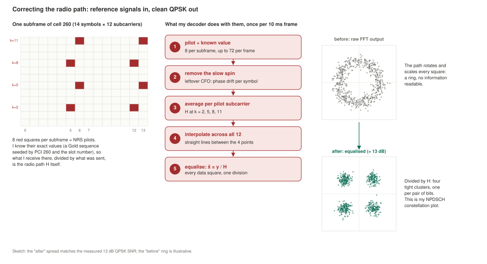

The grid I now have is right in shape but wrong in value. Every square has been rotated and scaled by the **radio channel**: the path from the tower's antenna to mine, plus whatever frequency error is left, plus my dongle's own response. Plot the raw numbers and you get a ring, not four dots. The decoder (Python block 2) has to measure that channel and divide it out.

The **NRS** squares exist for exactly this. Their values come from a Gold sequence (a pseudo-random ±1 sequence) seeded by the PCI and the slot number, so once I know I'm listening to PCI 260 I know exactly what was sent in each of them. Received value ÷ known value = the channel H at that square.

For every frame, the decoder:

1. **collects H at every NRS square**: 8 per subframe, up to 72 per frame;
2. **removes the slow spin**: the leftover frequency error makes H rotate a little from symbol to symbol. Comparing pilots 7 symbols apart on the same subcarrier measures that rotation;
3. **averages per pilot subcarrier**, giving H at subcarriers 2, 5, 8 and 11;
4. **interpolates across all 12 subcarriers**, with straight lines between those four points (and a gentle trend over time);
5. **equalises**: divides every data square by its H. With two transmit antennas this step becomes a 2 × 2 solve per pair of squares (the MIB-NB says this cell uses one, so here it's a plain division).

It also keeps the leftover scatter of the pilots around the model as a **noise estimate**. That number tells the error-correcting decoder how far to trust each square, and Part 15 turns the same measurement into a per-subframe SINR.

After equalisation, the constellation plots show four tight clusters. The decoder measures their quality with a blind estimator (comparing the average power with the average of power squared, which differ in a known way for clean QPSK): **about 13–14 dB** for the whole run.

---

## Part 9: error correction, how 34 bits become 1600

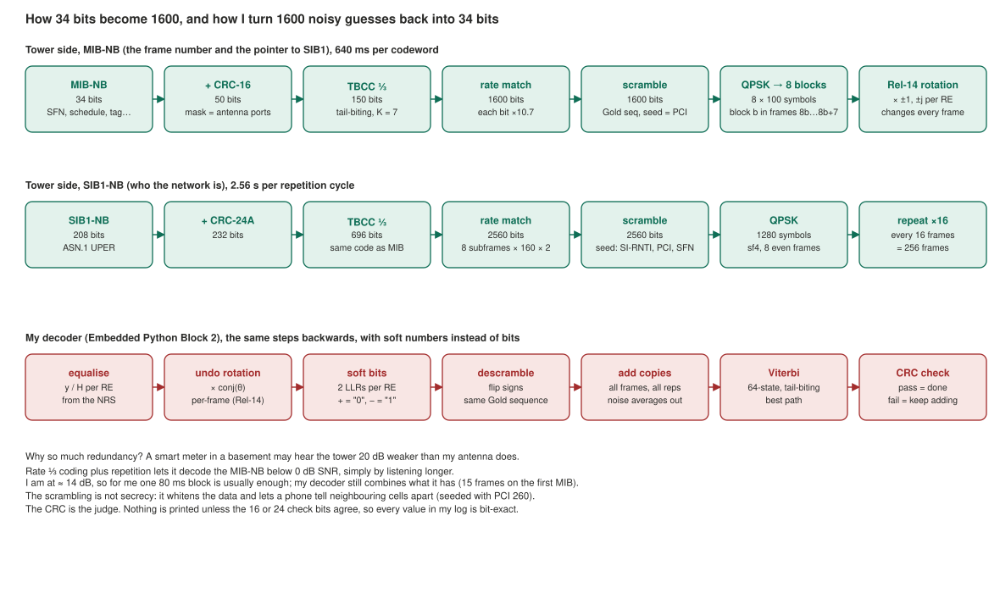

A meter in a basement may hear the tower 20 dB weaker than I do. NB-IoT protects its broadcasts so heavily that they can still be read there, and that protection is what my decoder has to undo.

### The tower side

For the MIB-NB:

1. **34 bits** of message;
2. **+ CRC-16**: a 16-bit checksum. It's XORed with a mask that says how many antennas the tower uses (all zeros for one, all ones for two), so a receiver learns the antenna count by seeing which mask makes the CRC pass;
3. **tail-biting convolutional code, rate ⅓** (TBCC): each bit becomes three, computed from it and the 6 bits before it (constraint length 7, the classic LTE code). "Tail-biting" means the encoder starts in the state it will end in, so no extra tail bits are needed;
4. **rate matching**: the 150 coded bits are interleaved and repeated to fill exactly **1600 bits**, so each bit is sent about 10.7 times;
5. **scrambling**: XOR with a Gold sequence seeded by the PCI. This isn't secrecy. It spreads the energy evenly, and it means a receiver tuned to the wrong cell gets garbage instead of the wrong message;
6. **QPSK** gives 800 symbols, split into **8 blocks of 100**: one block per NPBCH subframe. Each block is sent in **8 frames in a row**, so the full codeword takes 64 frames = 640 ms;
7. **Rel-14 rotation**: since Release 14, each frame's 100 symbols are also multiplied by ±1 or ±j from another Gold sequence that depends on the frame number mod 8, so the 8 copies of a block are no longer identical.

SIB1-NB and the SI messages follow the same pattern with a 24-bit CRC: 208 bits + 24 = 232, coded to 696, rate-matched to 2560 bits = 8 subframes × 160 squares × 2 bits (each subframe has 168 squares minus 8 NRS), and repeated up to 16 times.

### The receiver side

My decoder walks the chain backwards, but it never decides bits early. It works with **soft bits** (LLRs, log-likelihood ratios): a positive number means "probably 0", negative "probably 1", and the size says how sure. Equalised QPSK gives two soft bits per square for free: the real and imaginary parts, divided by the noise estimate.

Then: undo the Rel-14 rotation, flip the signs where the scrambler flipped bits, **add up every copy** of every bit (repetitions, all 8 frames of a block, several SIB1 repetitions if needed) so that noise averages out and the signal adds up, then a **Viterbi decoder** (it finds the most likely path through the code's 64 states; for tail-biting I run it on the codeword wrapped around itself) and finally the **CRC check**.

The CRC is the judge. If the 16 or 24 check bits don't match, nothing is printed and the decoder waits for more copies. So every value in my log is bit-exact: it passed a checksum computed by the tower. In this run, not a single SIB1-NB or SI message failed its CRC.

---

## Part 10: the MIB-NB, and the frame number hidden in time

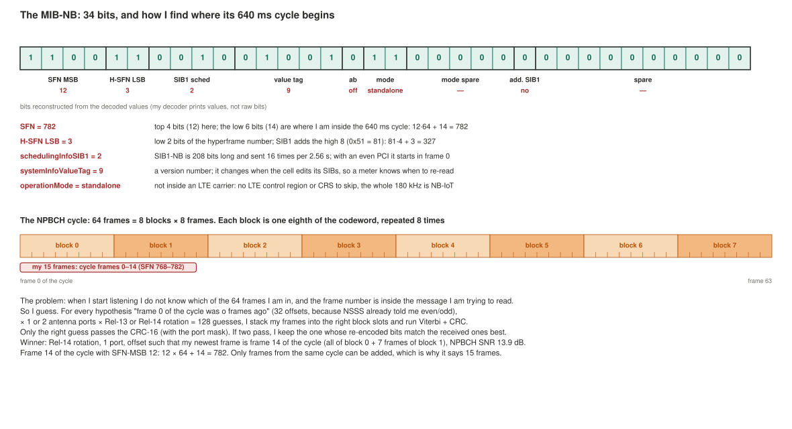

### The guessing game

To read the MIB-NB I have to add the 8 frames of each block into the right block's slot. To do that I need to know where the 640 ms cycle starts. And that's encoded in the frame number, which is inside the MIB-NB. Chicken and egg.

So the decoder guesses. Every hypothesis is "the cycle started *o* frames ago", combined with "one or two antennas" and "Rel-13 or Rel-14 rotation". The NSSS already told me which frames are even, which halves the offsets to 32, so 32 × 2 × 2 = **128 hypotheses**. For each one, the decoder stacks the frames it has into block slots, de-rate-matches, runs Viterbi and checks the CRC. All 128 in one numpy batch.

Only the right guess passes, almost always. The exception is Rel-13 towers: without the per-frame rotation, all 8 frames of a block are identical, and a guess that's off by a few frames inside a block can still pass. For that case the decoder re-encodes each passing MIB and keeps the one whose bits agree best with what it received.

The first decode needs at least 9 frames, so the stack always straddles a block boundary (8 identical frames prove nothing about where the block ends).

### What it printed

```
MIB-NB  (Rel-14 rotation, 1 NRS port, combined 15 frames, NPBCH SNR 13.9 dB)
  SFN = 782   (systemFrameNumber-MSB 12, H-SFN LSBs 3)
  schedulingInfoSIB1 = 2  ->  SIB1-NB TBS 208 bits, 16 repetitions, start frame 0
  systemInfoValueTag = 9   ab-Enabled = False   additionalTransmissionSIB1 = False
  operationModeInfo = standalone {}
```

Line by line:

- **Rel-14 rotation**: Telkomsel's software is at least Release 14 for this feature.
- **1 NRS port**: the CRC passed with the all-zeros mask, so one transmit antenna.
- **combined 15 frames**: the winning hypothesis put my newest frame at frame 14 of the cycle, so only frames 0 to 14 of this cycle could be added: all 8 of block 0 and 7 of block 1. Frames from the previous cycle carry a different codeword (a different frame number), so they can't be added.
- **NPBCH SNR 13.9 dB**: the equalised NPBCH symbols were very clean.
- **SFN = 782**: the message carries only the top 4 bits of the 10-bit frame number: **12**. The bottom 6 bits are my position inside the 640 ms cycle: frame 14. 12 × 64 + 14 = 782. That's the trick: half the frame number is *when* you received the message.
- **H-SFN LSBs 3**: the bottom 2 bits of the hyperframe number. The top 8 come in SIB1-NB.
- **schedulingInfoSIB1 = 2**: an index into a table in the spec. 2 means SIB1-NB is 208 bits and repeated 16 times per 2.56 s. With 16 repetitions, even PCIs start in frame 0 and odd PCIs in frame 1.
- **systemInfoValueTag = 9**: a version number for the system information. If Telkomsel changes a setting, it goes up, and every sleeping meter knows to re-read the SIBs when it wakes up.
- **ab-Enabled = False**: access barring is off. No device class is being told to stay away.
- **additionalTransmissionSIB1 = False**: no extra SIB1 copies in subframe 3 (a Release 15 option).
- **operationModeInfo = standalone**: confirms Part 1.

The decoder prints the MIB-NB only when its content (apart from the frame number) changes, which is why it appears exactly once in a 93-second log. It still re-checks it every 640 ms in the background.

---

## Part 11: SIB1-NB, and the broadcast timetable

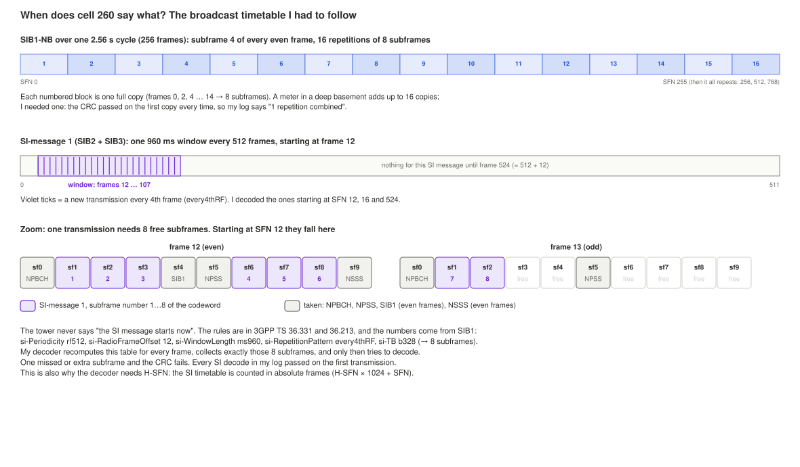

### Where SIB1 lives

The MIB-NB pointed to it: SIB1-NB is in subframe 4 of every even frame. One copy takes 8 subframes (frames 0, 2, 4 … 14), and 16 copies fill the 256-frame (2.56 s) cycle. A device in poor coverage can add up to 16 copies; I didn't need to: every one of my 60 SIB1 decodes passed its CRC on a single copy.

There's one more twist: the scrambling. Release 13 and Release 14 seed the scrambler differently, so the decoder tries both. The log says which one worked: `r14 scrambling`.

### What it printed

```
SIB1-NB  (1 repetition combined, r14 scrambling)  payload 40c510a88042ad724304fbd0cb070d0892c20000000000000000
{
  message c1 : systemInformationBlockType1-r13 : {
    hyperSFN-MSB-r13 '51'H -- Q --,
    cellAccessRelatedInfo-r13 {
      plmn-IdentityList-r13 { { plmn-Identity-r13 { mcc {5,1,0}, mnc {1,0} },
                               cellReservedForOperatorUse-r13 notReserved } },
      trackingAreaCode-r13 '56B9'H,
      cellIdentity-r13 '21827DE'H,
      cellBarred-r13 notBarred,
      intraFreqReselection-r13 allowed
    },
    cellSelectionInfo-r13 { q-RxLevMin-r13 -64, q-QualMin-r13 -23 },
    freqBandIndicator-r13 8,
    schedulingInfoList-r13 { { si-Periodicity-r13 rf512, si-RepetitionPattern-r13 every4thRF,
                               sib-MappingInfo-r13 { sibType3-NB-r13 }, si-TB-r13 b328 } },
    si-WindowLength-r13 ms960,
    si-RadioFrameOffset-r13 12,
    systemInfoValueTagList-r13 { 1 }
  }
}
```

(Compressed onto fewer lines here; the console prints one field per line.)

| Field | Raw | What it means |
|---|---|---|
| hyperSFN-MSB | '51'H = 81 | top 8 bits of the hyperframe number. With the MIB's LSB 3: 81 × 4 + 3 = **H-SFN 327** |
| `-- Q --` | – | just pycrate being helpful: byte 0x51 is the ASCII letter "Q". It means nothing here |
| mcc {5,1,0} | 510 | mobile country code: **Indonesia** |
| mnc {1,0} | 10 | mobile network code: **Telkomsel** |
| cellReservedForOperatorUse | notReserved | ordinary devices may use this cell |
| trackingAreaCode | '56B9'H = 22201 | the paging area. The network pages a sleeping device in all cells of its tracking area |
| cellIdentity | '21827DE'H | the 28-bit global cell ID: the first 20 bits are the eNodeB (the base station) = **137255**, the last 8 the cell = **222** |
| cellBarred | notBarred | open |
| intraFreqReselection | allowed | if this cell were barred, devices could move to another cell on the same frequency |
| q-RxLevMin | −64 | ×2 dB: devices may camp only if they receive the reference signal at **−128 dBm or better** |
| q-QualMin | −23 | the signal quality (RSRQ) must be at least **−23 dB** |
| freqBandIndicator | 8 | Band 8 |
| si-Periodicity | rf512 | SI message 1 repeats every 512 frames = **5.12 s** |
| si-RepetitionPattern | every4thRF | inside its window, a new copy starts every 4th frame |
| sib-MappingInfo | sibType3 | SI message 1 carries **SIB2** (always, implicitly) **plus SIB3** |
| si-TB | b328 | its transport block is 328 bits, which takes **8 subframes** |
| si-WindowLength | ms960 | the window lasts 960 ms (96 frames) |
| si-RadioFrameOffset | 12 | the window starts 12 frames into each 512-frame period |
| systemInfoValueTagList | {1} | a version number per SI message |

The payload is 26 bytes (208 bits), as the MIB-NB promised. Part 12 shows how those bytes become this text.

### Following the timetable

The tower never announces "SI message 1 starts now". The receiver has to compute it from SIB1: the window starts at frame 12 of every 512, lasts 96 frames, a new copy starts every 4th frame, and each copy fills the next **8 subframes that are free**. Free means: not subframe 0 (NPBCH), not 5 (NPSS), not 4 in SIB1 frames, not 9 in even frames (NSSS). Starting at frame 12, that's subframes 1, 2, 3, 6, 7, 8 of frame 12 and 1, 2 of frame 13 (the zoom in the picture).

My decoder recomputes this map for every frame, collects exactly those subframes, and only then decodes. One wrong subframe and the CRC fails. The log shows it worked every time:

```
[sinr] SI-message 1 @SFN 12: subframe SINR 13 15 17 16 15 14 16 14 dB -> 8 clean / 0 interfered; QPSK SNR clean 13.3, interfered --
```

Read as: SI message 1, the copy starting at SFN 12; the 8 subframes it used had SINR between 13 and 17 dB (Part 15); all 8 were above my 8 dB "clean" line; the QPSK from them measured 13.3 dB. 23 SI decodes in the run, at SFN 12, 16 and 524 (= 512 + 12), all passed.

This timetable is counted in *absolute* frames (H-SFN × 1024 + SFN), which is why the decoder needs the hyperframe number too. Here the 512-frame period divides 1024 evenly, so the H-SFN doesn't change the answer, but for a 2048- or 4096-frame period it would.

### The four SIB1 prints

The decoder re-reads SIB1 every 2.56 s, but it prints it again only when its content changes. In my log it printed four times, and the only thing that changed was hyperSFN-MSB: **'51'H, '52'H, '53'H, '54'H** (pycrate annotating them "Q", "R", "S", "T"). The top 8 bits of the hyperframe number tick every 4 hyperframes (40.96 s), so in 93 s I caught three ticks. That's my clock running alongside Telkomsel's: H-SFN 327 → 328 … 336.

---

## Part 12: ASN.1 UPER, or why the output looks like JSON

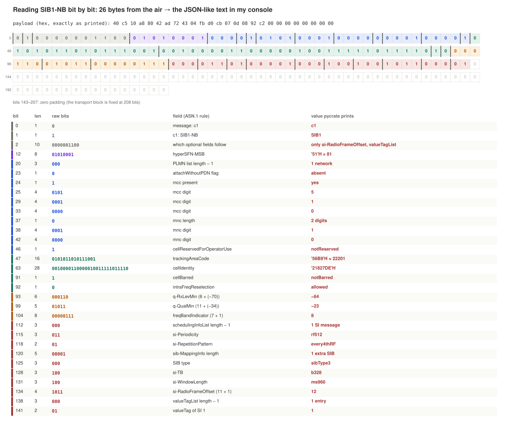

The braces-and-commas text looks like JSON, but it's **ASN.1 value notation**. ASN.1 (Abstract Syntax Notation One) is the language 3GPP uses to define its radio messages: "SIB1-NB is a sequence of these fields, this one is an integer from −70 to −22, that one is optional". On the air, the messages are packed with **UPER** (unaligned packed encoding rules), which is ruthless about bits:

- **no field names, no separators, no lengths** where the definition already fixes them. The decoder knows the order from the definition;
- an integer from −70 to −22 has 49 possible values, so it takes exactly **6 bits** and is sent as an offset from −70. 6 means −64;
- an optional field costs **1 bit** up front, saying whether it's there;
- a list costs a few bits of length, then its items;
- an enumeration (like `rf512`) is just its index: rf64 = 0, rf128 = 1, rf256 = 2, **rf512 = 3**.

The picture walks the whole message. The first 2 bits say "this is c1, and c1 is SIB1". The next 10 say which of SIB1's 10 optional fields are present: only si-RadioFrameOffset and systemInfoValueTagList. Then the hyperframe bits, the PLMN, the tracking area, the cell ID, and so on, down to bit 142. **143 bits** carry the whole message; the other 65 are zero padding, because the transport block size is fixed at 208.

I checked this walk by hand against pycrate's output, field by field. My Python block hands pycrate the 26 bytes, pycrate does exactly this walk using the official 3GPP ASN.1 definitions, and prints the result. Without pycrate installed, the decoder still prints the hex payload, since the CRC has already proved it right.

---

## Part 13: SI-message 1, SIB2-NB and SIB3-NB

SI message 1 is 328 bits and carries two blocks. SIB2-NB is the long one: how to access the cell. SIB3-NB is short: when to look for another cell. The full printout is in my log; here's what the values mean.

### SIB2-NB: random access

When a meter has something to send, it first knocks on the door with a **random access preamble** on the NPRACH (the uplink random access channel). These fields set the rules:

| Field | Value | Meaning |
|---|---|---|
| preambleInitialReceivedTargetPower | dBm-112 | aim the first knock to arrive at the tower at −112 dBm |
| powerRampingStep | dB2 | if nobody answers, try again 2 dB louder |
| preambleTransMax-CE | n4 | at most 4 knocks per coverage level |
| ra-ResponseWindowSize | pp10 | wait 10 control-channel periods for the answer |
| mac-ContentionResolutionTimer | pp64 | wait up to 64 periods to learn whether you won when two devices knock at once |
| nprach-CP-Length | us66dot7 | short preamble prefix: fine for cells up to about 10 km radius |
| rsrp-ThresholdsPrachInfoList | 31, 21 | coverage level boundaries at **−110 and −120 dBm** RSRP |
| nprach-Periodicity | ms640 (×3) | a knocking opportunity every 640 ms on each level |
| nprach-StartTime | ms8 / ms64 / ms128 | the three levels take turns inside the 640 ms |
| nprach-SubcarrierOffset / NumSubcarriers | n36 / n12 | 12 of the 48 uplink tones (3.75 kHz each), tones 36–47 |
| numRepetitionsPerPreambleAttempt | n2 / n8 / n32 | each knock repeated 2, 8 or 32 times |
| npdcch-NumRepetitions-RA | r8 / r16 / r128 | the answer's control message repeated up to 8, 16 or 128 times |
| maxNumPreambleAttemptCE | n4 | after 4 failed knocks, move to the next (deeper) level |

That's NB-IoT's **coverage enhancement** in one table. A device that hears the cell well (RSRP above −110 dBm) uses level 0: 2 repetitions, done in a few milliseconds. One in a basement below −120 dBm uses level 2: 32 repetitions per knock, and answers repeated 128 times. Same cell, same frequency, 16 times more air time for the hard case.

### SIB2-NB: paging, data, power and timers

| Field | Value | Meaning |
|---|---|---|
| modificationPeriodCoeff | n32 | SIB changes are announced 32 paging cycles ahead: **81.92 s** |
| defaultPagingCycle | rf256 | a sleeping device checks for pages every **2.56 s** (unless it negotiated longer sleep) |
| nB | one64thT | **4 paging frames** per 256-frame cycle; devices are spread over them by ID |
| npdcch-NumRepetitionPaging | r128 | a page can be repeated up to 128 times, for deep coverage |
| nrs-Power | 32 | each NRS square is sent at **32 dBm** (1.6 W). All 12 subcarriers at that level make about **43 dBm, roughly 20 W** |
| ack-NACK-NumRepetitions-Msg4 | r2 / r8 / r64 | how often a device repeats its acknowledgement, per coverage level |
| groupHoppingEnabled | FALSE | no uplink reference-signal hopping |
| p0-NominalNPUSCH | −100 | uplink power target: −100 dBm at the tower… |
| alpha | al1 | …with full path-loss compensation: a far device transmits louder by exactly its extra path loss |
| deltaPreambleMsg3 | 4 | ×2: the first data message is sent 8 dB relative to the preamble's power |
| t300 | ms60000 | a device gives up connecting after **60 s** (an LTE phone waits about 1 s) |
| t301 | ms25000 | 25 s to re-establish a dropped connection |
| t310, n310 | ms2000, n10 | after 10 "out of sync" indications, start a 2 s countdown to radio link failure |
| t311, n311 | ms30000, n1 | then 30 s to find a cell to recover on; one "in sync" is enough to cancel |
| additionalSpectrumEmission | 1 | default emission limits |
| timeAlignmentTimerCommon | infinity | uplink timing never expires. Meters don't move |

The 20 W figure assumes the data squares are sent at the same power as the NRS. That's typical but not guaranteed (how sure am I: **medium**). A 20 W NB-IoT carrier is a normal macro-cell setup.

Everything in this table is tuned for patience: 60-second connection timeouts, 128-fold repetitions, timing that never expires. Phones would find that unbearable. A meter that reports once a day doesn't care.

### SIB3-NB: when to look elsewhere

| Field | Value | Meaning |
|---|---|---|
| q-Hyst | dB4 | a neighbour must be 4 dB better before a device moves |
| s-IntraSearchP | 29 | ×2 = 58 dB above the minimum: search for neighbours when RSRP falls below about **−70 dBm** (−128 + 58) |
| s-NonIntraSearch | 9 | ×2 = 18 dB, the threshold for searching other frequencies, but none are listed |
| q-RxLevMin | −64 | the same −128 dBm minimum for neighbour cells |
| t-Reselection | s3 | a better neighbour must stay better for 3 s before the device moves |

The most interesting thing in SIB3 is what's **missing**: there's no list of other frequencies, and SIB1 doesn't schedule SIB5 (the block that would carry them). The only neighbours a device can move to are on the same carrier. From inside the protocol, that's frequency reuse 1.

---

## Part 14: what cell 260 told me

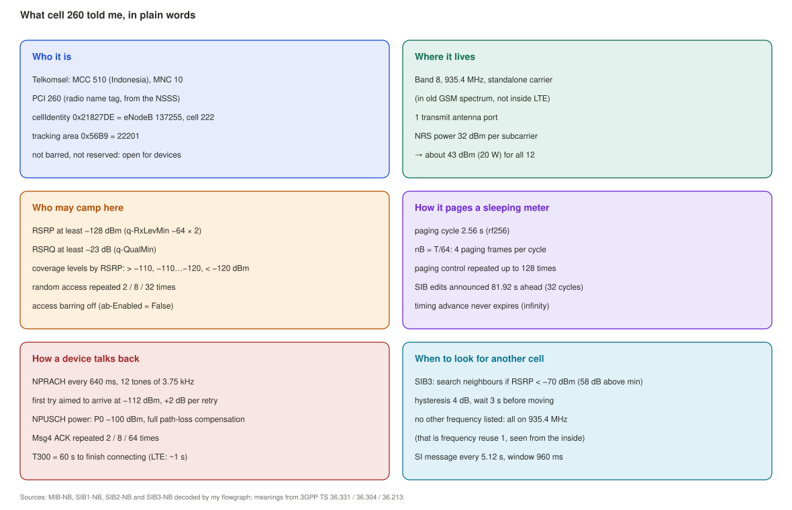

Put together, in plain words: I'm listening to **eNodeB 137255, cell 222** of **Telkomsel** (510-10), physical cell ID **260**, tracking area **22201**, a standalone NB-IoT carrier at **935.4 MHz** in Band 8, one antenna, about 20 W. It accepts devices down to −128 dBm, sorts them into three coverage levels at −110 and −120 dBm, pages sleepers every 2.56 s in one of 4 paging frames, and tells them to look for a better cell only when the signal drops below about −70 dBm, and only on the same frequency.

What *kind* of devices use it, I can't see: everything a device sends goes on the uplink, which is a different frequency (Band 8 uplink, 45 MHz lower) that I didn't listen to, and the downlink data is addressed by temporary IDs. My best guess is smart electricity meters, which are common in houses here (how sure: **low to medium**; it's what fits the settings, not something I decoded).

---

## Part 15: hearing the neighbours, frequency reuse 1 in my own data

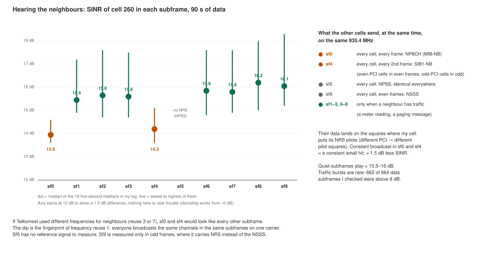

### How the decoder measures SINR

For every subframe that carries NRS, the decoder compares each pilot with the frame-wide channel model from Part 8. The model is smooth: it's built from up to 72 pilots spread over the frame. A pilot that has something extra on top of it (noise, or another cell's signal landing on that square) sticks out from the model. So:

**SINR = model power ÷ leftover power at the pilots** (signal to interference plus noise ratio), one number per subframe, about ±1.5 dB of scatter because each subframe has only 8 pilots.

It sends 10 values per frame to the **SINR raster** (one row per frame, dark = good) and prints a summary every 5 seconds:

```
[sinr] last 5 s, per subframe median/10th-pct dB, % below 8 dB:  sf0 14.5/12.8  0%  sf1 16.5/13.4  0%  sf2 16.0/13.1  0%  sf3 16.3/12.8  0%  sf4 14.7/12.6  1%  sf5   --     sf6 16.6/13.2  0% ...
```

For each subframe: the median, the 10th percentile (the bad tail), and how often it fell below my 8 dB "clean" line. Subframe 5 has no NRS (it's all NPSS), so no measurement.

### The pattern

Over the whole run, two subframes are consistently lower than the rest:

| Subframe | 0 | 1 | 2 | 3 | 4 | 6 | 7 | 8 | 9 |
|---|---|---|---|---|---|---|---|---|---|
| median SINR (dB) | **13.9** | 15.4 | 15.6 | 15.6 | **14.2** | 15.9 | 15.8 | 16.2 | 16.1 |

About **1.5 dB lower in subframes 0 and 4**, every 5-second window, for 90 seconds. That isn't chance.

### Why subframes 0 and 4

Because of reuse 1. Every NB-IoT cell around me transmits on 935.4 MHz, synchronised to the same frame timing, and every one of them broadcasts the same channels in the same subframes:

- **subframe 0**: every cell sends its NPBCH, in every frame, always;
- **subframe 4**: every cell sends its SIB1-NB, in every other frame (even PCIs in even frames, odd PCIs in odd frames), always;
- **subframes 1–3 and 6–8**: a neighbour only transmits there when it has traffic for one of its devices.

The neighbours' NPBCH and SIB1 fill almost all of their squares, including the ones where *my* cell puts its NRS (a different PCI puts its own NRS elsewhere, so it fills mine with data). So in subframes 0 and 4 my pilots always carry a little of every neighbour's broadcast on top. In the other subframes they mostly don't.

1.5 dB is a small hit. Roughly, the neighbours' combined broadcast arrives about 3 to 4 dB below the noise and estimation error I already had (how sure: **medium**; it depends on how much of the 15.5 dB "floor" is real noise). Small, but constant, and it lines up exactly with the frame structure. If Telkomsel used reuse 3 or 7, subframes 0 and 4 would look like every other subframe.

### Clean and interfered constellations

The decoder also sorts the SIB1 and SI symbols by the SINR of the subframe they came from: **CLEAN** (≥ 8 dB) and **INTERFERED** (< 8 dB), each with its own constellation plot. In this run the interfered plot stayed nearly empty: **662 of 664** data subframes I checked were clean, and the two exceptions were just under the line (they print as 8 dB, rounded). The clean QPSK measured **13.4 dB** median (11.6–16.5 dB over 83 decodes).

The neighbours' traffic bursts, which would show up as random light dots in subframes 1–3 and 6–8 of the raster, were rare. At this spot, cell 260 dominates comfortably.

---

## Part 16: the run in numbers

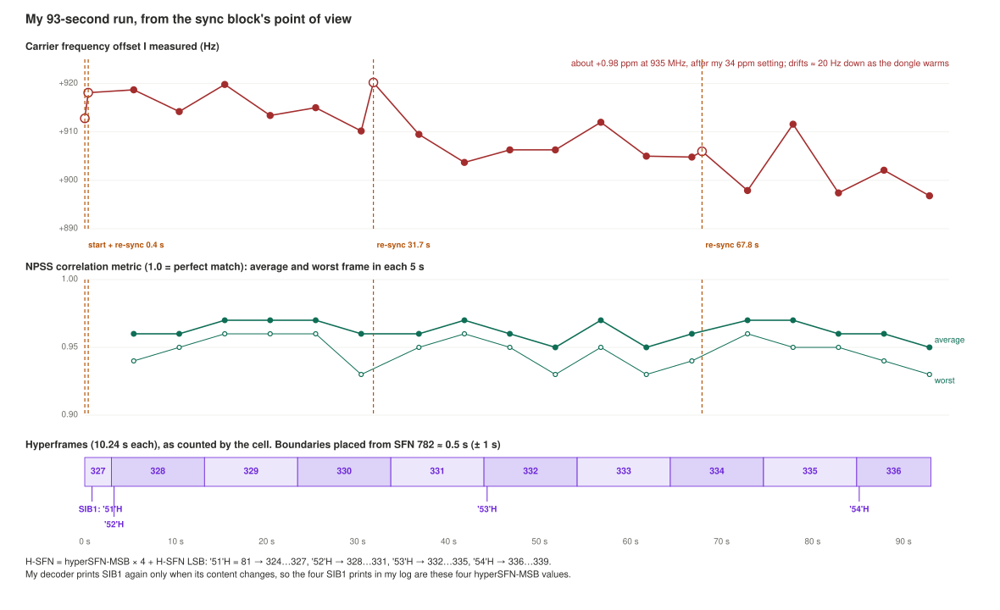

| What | Result |
|---|---|
| **Duration** | about 93 s |
| **Cell** | PCI 260, NSSS 11.0 × the noise floor (10.9 after the last re-sync); no other cell above the candidate threshold |
| **NPSS metric** | 0.95–0.97 average per 5 s, worst frame 0.93 |
| **CFO** | +913 to +918 Hz at the start, +897 Hz at the end (+0.98 ppm after my 34 ppm setting); it drifted about 20 Hz down as the dongle warmed up |
| **MIB-NB** | decoded from 15 frames, NPBCH SNR 13.9 dB; SFN 782 at the start |
| **SIB1-NB** | 60 decodes, every one from a single repetition, 0 CRC failures |
| **SI-message 1** (SIB2 + SIB3) | 23 decodes, every one from a single transmission, 0 CRC failures |
| **Hyperframes** | H-SFN 327 → 336 (hyperSFN-MSB '51'H → '54'H) |
| **SINR** | 13.9–16.2 dB median by subframe; 662 of 664 data subframes above 8 dB |
| **QPSK SNR** (equalised data) | 13.4 dB median |
| **Re-syncs** | 3 (at about 0.4 s, 31.7 s and 67.8 s), each recovered within about 1 s at the same CFO and PCI |

### The three re-syncs

The first one is at startup: the Sync block locked within the first 7 ms, lost it, and locked again at 0.38 s. That's most likely the AGC and the dongle still settling. The other two, at about 31 s and 67 s, came out of nowhere: the metric was 0.93 or better right before. Losing it means 10 frames in a row missed the NPSS by more than ±3 samples, which looks like a jump in the sample stream rather than a fading signal. My guess is a short USB hiccup that dropped samples (how sure: **low**; there's no overflow message in the log, so I can't prove it).

Either way, recovery was quick. The Sync block searches narrowly around the last known frequency first, finds the NPSS within a second, and the decoder starts over: NSSS, MIB-NB, SIB1. It remembers what it already printed, so the console doesn't fill with repeats.

---

## Surprises along the way

### 1. Half the frame number is a time, not a value

I expected the frame number to be in the MIB-NB. Only its top 4 bits are. The other 6 are *where* in the 640 ms cycle you received it, which you can only work out by trying every possibility until a CRC passes. It's an elegant way to save 6 bits, and the reason the MIB decoder is the most "search-like" part of the whole receiver.

### 2. Two ways to shift half a subcarrier

The 7.5 kHz half-subcarrier offset can be generated with the phase restarting at every symbol or running continuously. The difference is a phase step of a few degrees per symbol. Small, but enough to tilt a correlation. Rather than guess, the Sync block carries templates for both and reports which one fits: `half-subcarrier per-symbol` for this cell.

### 3. Rel-13 or Rel-14? Try both

Release 14 changed both the NPBCH (the per-frame rotation) and the SIB scrambling seed. The MIB decoder tries both versions as part of its 128 hypotheses, and the SIB decoder tries both scramblers. This cell uses Release 14 for both. The decoder prints which one worked, so I don't have to wonder.

### 4. "-- Q --" is not a field

My first thought on seeing `hyperSFN-MSB-r13 '51'H -- Q --` was that I'd decoded something wrong. It's pycrate printing the ASCII character for byte 0x51 next to bit strings, which it does for any 8-bit string. The next prints said R, S and T. The hyperframe number spelling the alphabet.

### 5. SIB3 in the mapping, SIB2 in the message

SIB1 says SI message 1 contains `sibType3-NB-r13`, and the decoder labelled it that way, but the message starts with SIB2. That's the spec: SIB2 is always in the first SI message and is never listed. The mapping only lists the *extra* blocks.

### 6. A hyperframe that flickers

While counting the SIB1 decodes for this document, I noticed a pattern: after every hyperframe boundary, SIB1 gets decoded three times instead of once (SFN 0, 16 and 64). The cause: when SIB1 arrives, the decoder rebuilds the H-SFN from SIB1's top bits plus the MIB's *last* bottom bits, and the MIB is only re-checked every 640 ms. For frames 14 to 63 after each boundary, the H-SFN is briefly 3 too high, then corrects itself. It's harmless here (the extra decodes are correct, and a 512-frame SI period doesn't care about the H-SFN), but it's a real bug, now on the TODO list. Lesson, again: **count from the data**.

---

## What I can't (and won't) decode

- **The uplink.** Everything devices send is 45 MHz lower, on a different channel structure. I didn't listen there.
- **Downlink traffic to devices.** It's addressed to temporary IDs, scheduled by control messages I don't decode, and above the radio layer it's encrypted. I wouldn't decode it even if I could: it's someone's data. The broadcast is meant for everyone; the traffic isn't.
- **In-band cells.** The decoder handles their sync and MIB-NB, but SIB decoding would need to skip LTE's control region and reference signals, which I haven't done. Telkomsel's carrier here is standalone, so it didn't matter.
- **Absolute power.** An RTL-SDR isn't calibrated, so I can't say what RSRP my antenna gets in dBm. The SINR and the SNR are ratios, and those I trust.

---

## How to run it

1. Plug in the RTL-SDR and find the carrier in Gqrx first: a flat-topped block about 180 kHz wide. Note its centre and your dongle's ppm.
2. Open **nbiot_rx_sinr.grc** in GRC (GNU Radio 3.10, radioconda).
3. Set:
   - **NB-IoT carrier [Hz]**: the centre, 935.4e6 here. Standalone carriers sit on the 100 kHz raster.
   - **RTL ppm**: the same value as in Gqrx (34 for my dongle).
   - **RTL gain**: about 30 dB. Too much gain and the strong GSM/LTE neighbours overload the dongle.
   - **Fine tune**: 0. The Sync block searches ±12 kHz by itself.
   - **Clean/interfered split**: 8 dB (only read at start).
4. For the full SIB text, install pycrate once: `radioconda\python.exe -m pip install pycrate`. Without it you still get the MIB-NB and the SIB payloads in hex.
5. Run. Within a second or two you should see `[sync] NPSS found`, then `Cell found`, then the MIB-NB within about a second, SIB1 within 3 s, and SI message 1 within about 5 s (it comes every 5.12 s).

On the GUI:

- **Spectrum**: the 180 kHz block in the middle.
- **NPSS raster**: a straight bright vertical line = a cell is there. A slanted line means a large frequency error.
- **Resource grid raster**: the frame from Part 4, live. NPSS and NPBCH squares should stand out in their places.
- **Constellations**: NPBCH, NPDSCH clean, NPDSCH interfered. Four tight dots = everything's working.
- **SINR raster**: 10 columns per row (subframes 0–9), dark = good. Look for the slightly lighter columns 0 and 4.

A few notes:

- **`[sync] searching...` forever**: check the frequency and the ppm. The block needs a peak at least 12 times its typical value (the `ratio` it prints); a ratio of 2–3 means it found nothing but noise.
- **Cell found, but no MIB-NB**: the decoder tries other candidate cells after about a second. A very low NPBCH SNR (it's printed while searching) means the signal is too weak; move the antenna.
- **`O` characters in the console**: the laptop can't keep up and is dropping samples. Close other programs.

---

## TODO

There's a lot of room for improvement!

- **Fix the flickering H-SFN** (surprise 6): take the H-SFN bottom bits from the frame counter, not from the last MIB.
- **Find the neighbours**: subtract cell 260's NSSS and search again, the way FT8 decoders peel strong stations off to find weak ones. Their PCIs would show which towers I'm hearing.
- **Decode the control channel (NPDCCH)** for paging: count how often devices are paged, without decoding who.
- **Measure RSRP** properly with a calibrated reference, so q-RxLevMin and the coverage thresholds mean something for my own antenna.
- **Log the SINR over a day**, to see whether the neighbours' traffic follows meter-reading schedules.
- **In-band cells**, for operators that run NB-IoT inside LTE.

---

## Acknowledgements

- The **GNU Radio** project, and **radioconda** for making it painless on Windows.
- **3GPP**, for specifications detailed enough that a receiver can be built from them alone.
- **srsRAN**, whose open NB-IoT code I read to understand the parts the spec leaves to interpretation.
- **pycrate** (Benoit Michau), for the ASN.1 compiler and the 3GPP definitions that turn 26 bytes into readable text.
- **Telkomsel's cell 260**, for broadcasting cleanly and patiently, every 10 ms, to anyone who cares to listen.
